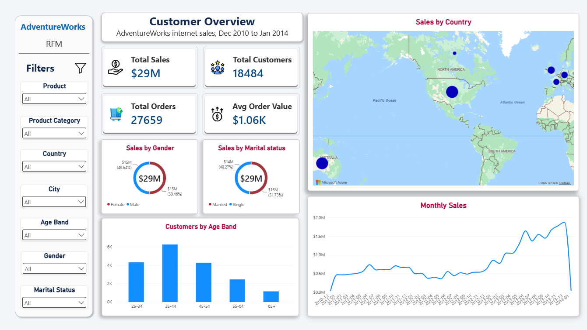
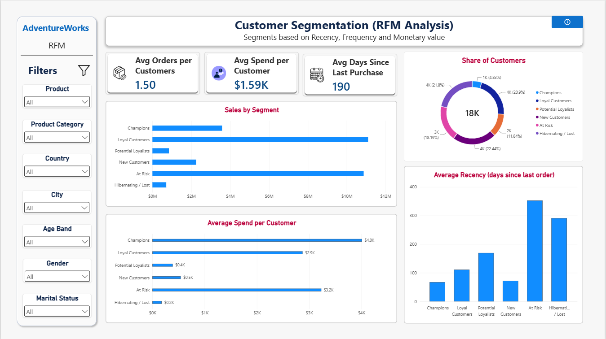
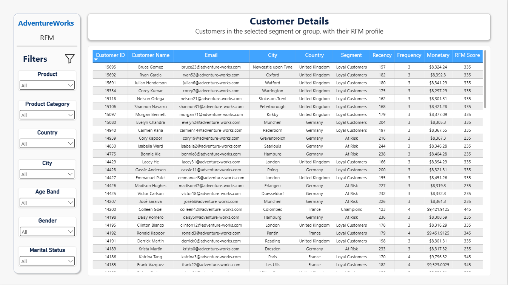
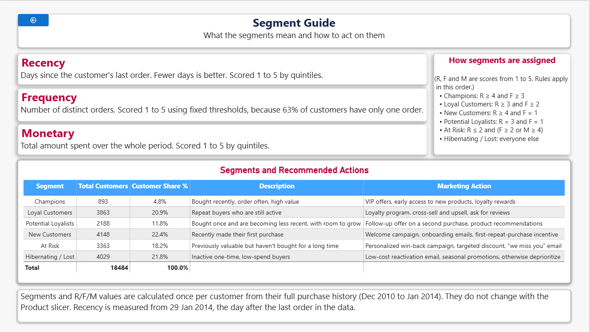

# Syntecxhub Customer Segmentation using RFM Analysis 

An end-to-end customer analytics project built on the **AdventureWorks Data Warehouse**. Customers are scored on **Recency, Frequency, and Monetary value (RFM)**, grouped into six actionable segments, and explored in a four-page Power BI dashboard with targeted marketing recommendations for each segment.

> Internship project, Syntecxhub.

---

## Table of contents

1. [Project objectives](#1-project-objectives)
2. [Dataset](#2-dataset)
3. [Tools](#3-tools)
4. [Repository structure](#4-repository-structure)
5. [Steps to reproduce](#5-steps-to-reproduce)
6. [RFM methodology](#6-rfm-methodology)
7. [Dashboard and interpretation](#7-dashboard-and-interpretation)
8. [Marketing recommendations](#8-marketing-recommendations)
9. [Conclusion](#9-conclusion)
10. [Limitations](#10-limitations)

---

## 1. Project objectives

| Requirement | How it is met |
|---|---|
| Clean and prepare transactional customer data | SQL validation checks, then Power Query cleaning (types, trimmed text, readable labels) |
| Calculate RFM metrics | `RFM Table` in DAX: one row per customer with Recency, Frequency, Monetary |
| Segment customers (loyal, churn risk, new) | Six rule-based segments, including Loyal Customers, At Risk, and New Customers |
| Analyze behavior patterns of each segment | Segmentation page: customer share, sales, average spend, and average recency per segment |
| Provide targeted marketing recommendations | `RFM_Segment_Guide.xlsx` and the Segment Guide page, plus a customer drill-through list |
| Visualize segments with charts or dashboards | Four-page Power BI report |

---

## 2. Dataset

**AdventureWorksDW2025**, Microsoft's official sample data warehouse for the fictional bicycle company *Adventure Works Cycles*. The data is generated, so it contains no real customers.

- Download: [AdventureWorksDW2025.bak](https://github.com/Microsoft/sql-server-samples/releases/download/adventureworks/AdventureWorksDW2025.bak)
- Install and restore guide: [Microsoft Learn, AdventureWorks install and configure](https://learn.microsoft.com/en-us/sql/samples/adventureworks-install-configure?view=sql-server-ver17&tabs=ssms)

The `.bak` file is **not stored in this repository** because of its size. Download it from the link above and place it in `Raw_Data/raw/`, which is excluded through `.gitignore`.

**Tables used**

| Table | Role |
|---|---|
| `FactInternetSales` | Fact table: online orders (60,398 rows) |
| `DimCustomer` | Customer attributes (18,484 rows) |
| `DimGeography` | City, state and country |
| `DimProduct` | Products |
| `DimProductSubcategory`, `DimProductCategory` | Product category hierarchy |
| `DimDate` | Calendar table |

The database holds about 30 tables covering finance, HR, resellers, and more. Only the online-customer slice is relevant to the RFM, since reseller sales are made to shops, not individual customers.

**Key facts confirmed by SQL**

| Item | Value |
|---|---|
| Order date range | 2010-12-29 to 2014-01-28 |
| Customers who bought | 18,484 |
| Total orders | 27,659 |
| Total sales | $29,358,677.22 |
| Recency reference date | 2014-01-29 (last order date + 1) |

---

## 3. Tools

- **SQL Server** and **SQL Server Management Studio (SSMS)**: restore and validation
- **Power BI Desktop**: Power Query, data model, DAX, and report
- **Excel**: segment guide workbook (`RFM_Segment_Guide.xlsx`)

---

## 4. Repository structure

```
Syntecxhub_Customer_Segmentation_using_RFM_Analysis
│
├── Raw_Data/
│   ├── raw/                      # AdventureWorksDW2025.bak goes here (not committed)
│   └── reference/
│       └── RFM_Segment_Guide.xlsx
│
├── SQL/
│   └── validation_queries.sql
│
├── PowerBI/
│   └── Customer_Segmentation_RFM.pbix
│
├── Dashboard_Images/
│   ├── page1_overview.png
│   ├── page2_rfm.png
│   ├── page3_details.png
│   └── page4_guide.png
│
├── .gitignore
├── README.md
└── Project_Report.pdf
```

---

## 5. Steps to reproduce

### Step 1: Restore the database
1. Install SQL Server (Express or Developer) and SSMS.
2. Copy `AdventureWorksDW2025.bak` into the SQL Server `Backup` folder, so the service account can read it.
3. In SSMS: right-click **Databases → Restore Database → Device**, select the file, and restore.
4. The restore needs SQL Server 2025. On an older version, use the `AdventureWorksDW2022.bak` from the same release page.

### Step 2: Validate the data in SQL
All queries are in [`SQL/validation_queries.sql`](SQL/validation_queries.sql). They confirm that:
- row counts are non-zero for every table used;
- there are no NULL keys, no duplicate dimension keys, and no orphan sales rows;
- order dates are valid, and sales amounts are never NULL or negative;
- reference totals (customers, orders, sales) are recorded to cross-check against Power BI later;
- the frequency distribution is known before scoring (see [Methodology](#6-rfm-methodology)).

### Step 3: Connect Power BI to SQL Server
1. **Get data → SQL Server**, using the server name from SSMS and database `AdventureWorksDW2025`, in **Import** mode.
2. Select the seven tables listed above and click **Transform Data**.
3. Turn off *Auto date/time*, since a real `DimDate` table exists.

### Step 4: Clean the data in Power Query
- Keep only the needed columns in each table to reduce model size.
- Set correct types: dates as *Date*, `SalesAmount` as *Fixed decimal number*, keys as *Whole number*.
- Trim names and email addresses; replace `M`/`F` with Male/Female and `M`/`S` with Married/Single.
- Add `Customer Name`; rename columns to readable names (`Country`, `ProductName`, and so on).
- Check that every kept column shows 100% valid, 0% error, and 0% empty.

### Step 5: Build the data model
Star schema, all relationships many-to-one with single direction:

```
DimGeography ─▶ DimCustomer ─▶ FactInternetSales ◀─ DimProduct ◀─ DimProductSubcategory ◀─ DimProductCategory
                                      ▲
                                   DimDate
```

`DimDate` is marked as the date table. Key columns are set to *Don't summarize* and hidden.

### Step 6: Create customer attributes
- **Age**, calculated as of 2014-01-29 because the data is historical.
- **Age Band**: 25-34, 35-44, 45-54, 55-64, 65+. The youngest customer is 27, so there is no under-25 group.
- **Age Band Sort**, used as the sort column.

### Step 7: Create base measures
`Total Sales`, `Total Orders`, `Total Customers`, `Avg Order Value` and `Reference Date`, stored in a `_Measures` table. Checked their values against the SQL totals before building any visuals.

### Step 8: Build the RFM table
A DAX calculated table with one row per customer:

| Column | Definition |
|---|---|
| Recency | Days between the customer's last order and the reference date (2014-01-29) |
| Frequency | `DISTINCTCOUNT` of `SalesOrderNumber`, since one order can have several lines |
| Monetary | Sum of `SalesAmount` |

The table has 18,484 rows, and its Monetary column sums to $29,358,677.22, matching SQL.

### Step 9: Score and segment
- **R and M** are scored 1 to 5 by quintiles (percentiles). For Recency, the direction is reversed, so recent buyers score 5.
- **F** uses fixed thresholds, because percentile cut-offs fail on this data (see below).
- The three digits form the `RFM Score` (for example, 445), and DAX `SWITCH` rules assign one of six segments.
- Segment descriptions and marketing actions come from `RFM_Segment_Guide.xlsx`, related to the RFM table through the `Segment` column.

### Step 10: Build the dashboard
- The pages were designed directly in Power BI, so slicers, spacing, and colors stay editable. 
- A shared filter panel with seven slicers (Product, Product Category, Country, City, Age Band, Gender, and Marital Status) is repeated on pages 1 to 3.

| Page | Purpose |
|---|---|
| Customer Overview | Who the customers are and where sales come from |
| Customer Segmentation (RFM) | Size, value, and behavior of each segment |
| Customer Details | Drill-through customer list for targeted campaigns |
| Segment Guide (hidden) | Definitions, segment rules, descriptions, and recommended actions |

### Step 11: Validate
- Cards matched SQL: $29,358,677.22 sales, 18,484 customers, 27,659 orders.
- R, F, and M score distributions each sum to 18,484, and F matches the SQL frequency table.
- Manual spot checks on several customers matched the DAX scores.
- Segment counts sum to 18,484 and segment sales sum to total sales.
- Drill-through counts match the segment counts on page 2.

---

## 6. RFM methodology

| Metric | Meaning | Better when |
|---|---|---|
| **Recency** | Days since the last purchase | lower |
| **Frequency** | Number of distinct orders | higher |
| **Monetary** | Total amount spent | higher |

**Why Frequency uses fixed thresholds.** Most customers bought only once or twice, so percentile cut-offs (20th to 80th) would be identical and the 1 to 5 scale meaningless.

| Orders | Customers | F Score |
|---|---|---|
| 1 | 11,619 (62.9%) | 1 |
| 2 | 5,454 (29.5%) | 2 |
| 3 | 1,166 (6.3%) | 3 |
| 4 | 150 (0.8%) | 4 |
| 5 or more | 95 (0.5%) | 5 |

The score therefore equals the order count, capped at 5, which also stops a few customers with 16 to 28 orders from distorting results.

**Why the reference date is 2014-01-29.** Fixing it at the day after the last order keeps results stable and meaningful.

**Segment rules** (applied in this order):

| Segment | Rule |
|---|---|
| Champions | R ≥ 4 and F ≥ 3 |
| Loyal Customers | R ≥ 3 and F ≥ 2 |
| New Customers | R ≥ 4 and F = 1 |
| Potential Loyalists | R = 3 and F = 1 |
| At Risk | R ≤ 2 and (F ≥ 2 or M ≥ 4) |
| Hibernating / Lost | everyone else |

---

## 7. Dashboard and interpretation

### Page 1: Customer Overview



| Visual | What it shows | Interpretation |
|---|---|---|
| **Total Sales** | $29M | Total internet sales from Dec 2010 to Jan 2014 ($29,358,677 exactly). |
| **Total Customers** | 18,484 | Every customer in the data has made at least one purchase. |
| **Total Orders** | 27,659 | About 1.5 orders per customer, so most customers buy rarely. |
| **Avg Order Value** | $1.06K | A typical order is worth about $1,060, which fits a business selling bikes alongside lower-priced accessories. |
| **Sales by Gender** | Female 50.5%, Male 49.5% | Sales are almost evenly split, so gender is not a useful basis for targeting. |
| **Sales by Marital Status** | Married 51.7%, Single 48.3% | A small lean towards married customers, again a weak differentiator. |
| **Customers by Age Band** | Peak at 35-44 | The 35-44 group is the largest, at roughly a third of customers. Together with 25-34 and 45-54, it makes up most of the base, while 55-64 and 65+ are small. Campaigns should focus on the 25 to 54 range. |
| **Sales by Country (map)** | Bubble size is sales | The United States and Australia carry the largest bubbles, Western Europe (UK, Germany, France) shows three mid-sized bubbles, and Canada is the smallest. Sales are concentrated in a few markets. |
| **Monthly Sales** | Line over time | Sales grow steadily from about $0.5M a month in 2011 to about $1.9M by late 2013, with a visible rise from 2013. The drops to near zero in Dec 2010 and Jan 2014 reflect incomplete months at the edges of the data, not real declines. |

### Page 2: Customer Segmentation (RFM)



| Segment | Customers | Share of customers |
|---|---|---|
| Champions | 893 | 4.8% |
| Loyal Customers | 3,863 | 20.9% |
| Potential Loyalists | 2,188 | 11.8% |
| New Customers | 4,148 | 22.4% |
| At Risk | 3,363 | 18.2% |
| Hibernating / Lost | 4,029 | 21.8% |
| **Total** | **18,484** | **100%** |

| Visual | Interpretation |
|---|---|
| **Avg Orders per Customer: 1.50** | Matches the overall orders-per-customer ratio, and confirms that repeat buying is limited. |
| **Avg Spend per Customer: $1.59K** | Average lifetime spend per customer. Segment averages below show how far the groups differ from this figure. |
| **Avg Days Since Last Purchase: 190** | On average, customers last bought about six months before the end of the data, so a large part of the base is no longer active. |
| **Share of Customers (donut)** | The base is split into three large groups (New, Hibernating / Lost, Loyal at roughly 21 to 22% each), with At Risk at 18%. Champions are a small elite at under 5%. |
| **Sales by Segment** | Sales are highly concentrated. **Loyal Customers and At Risk each bring in about $11M**, together about 75% of all sales from roughly 39% of customers. Champions follow at about $3.6M. New Customers, Potential Loyalists, and Hibernating / Lost together contribute only a small share. |
| **Average Spend per Customer** | Champions spend the most (about $4.0K each), followed by At Risk ($3.2K) and Loyal ($2.9K). Potential Loyalists ($0.4K), New Customers ($0.5K), and Hibernating / Lost ($0.2K) spend little. |
| **Average Recency** | New Customers (about 70 days) and Champions (about 70 days) bought most recently; Loyal about 110 days. At Risk is the least recent at about 350 days, followed by Hibernating / Lost at about 290 days. |

**Key insight:** At Risk customers are as valuable as Loyal ones (about $3.2K against $2.9K per customer), but they haven't bought for nearly a year. This is the best opportunity for a win-back campaign.

### Page 3: Customer Details (drill-through)



Right-click a segment, country, gender, marital status, or age band on pages 1 and 2, then choose **Drill through → Customer Details** to see exactly who is in that group. The table shows Customer ID, name, email, location, segment, Recency, Frequency, Monetary, and RFM Score.

**Interpretation:** This page turns a segment label into a usable target list. For example, drilling down from *At Risk* gives marketing the customers to contact in a win-back campaign, along with their value and last-purchase age to prioritize. Names and emails are fictional AdventureWorks data. In a real company, this page would be restricted to the marketing team for privacy reasons.

### Page 4: Segment Guide (hidden page)



Opened from the information button on page 2. It defines Recency, Frequency, and Monetary, lists the segment rules, and shows each segment's customer count, description and recommended marketing action.

---

## 8. Marketing recommendations

| Segment | Customers | Recommended action |
|---|---|---|
| **Champions** | 893 | VIP offers, early access to new products, loyalty rewards. Protect this small, very valuable group. |
| **Loyal Customers** | 3,863 | Loyalty program, cross-sell and upsell, ask for reviews. They are a main revenue source. |
| **Potential Loyalists** | 2,188 | Follow-up offer on a second purchase and product recommendations. They bought once and are fading. |
| **New Customers** | 4,148 | Welcome campaign, onboarding emails, and an incentive for the first repeat purchase. This is the largest group, so converting even a small share to repeat buyers raises revenue. |
| **At Risk** | 3,363 | Personalized win-back campaign, targeted discount, "we miss you" email. Highest priority given their past value. |
| **Hibernating / Lost** | 4,029 | Low-cost reactivation email and seasonal promotions; otherwise, deprioritize. They have low spend and low return on effort. |

---

## 9. Conclusion

- The business has **18,484 customers and $29.4M in sales**, but loyalty is weak: **63% of customers bought only once**.
- Revenue is concentrated. **Loyal Customers and At Risk customers generate about three-quarters of sales** from about 39% of customers, so protecting these two groups matters most.
- **At Risk customers are the biggest opportunity.** They spend nearly as much per customer as Loyal ones, but have been inactive for almost a year. A win-back campaign here has the best expected return.
- **New Customers are the biggest growth lever.** At 22% of the base, converting them into repeat buyers would grow the Loyal and Champions groups.
- **Hibernating / Lost customers** are numerous but low in value, so they should be contacted with low-cost campaigns only.
- Demographics (gender, marital status) are almost evenly split and do not separate customers well. **Behavior (RFM)** is a far better basis for targeting than demographics.
- Sales grew strongly through 2013, and the customer base is concentrated in the 25 to 54 age range and in a few countries.

The project shows how RFM turns raw transactions into groups that marketing can act on, and how a dashboard with drill-through links each group to real customers.

---

## 10. Limitations

- The data is **fictional and historical** (Dec 2010 to Jan 2014), so the findings illustrate the method rather than describe a real business.
- Dec 2010 and Jan 2014 are incomplete months and should not be read as trends.
- Frequency scoring uses fixed thresholds because of the data's shape, so scores are not strictly quintiles.
- Quintile scoring of Monetary leaves the lowest score slightly larger (4,124 customers) than the others, because many customers share the same low spend.
- Segments and R/F/M values are calculated once from each customer's full history, so they do **not** change with the Product slicer. This is intentional.
- Segment rules are one reasonable design. A different business might choose different thresholds.

---

## Author

**May Chellouf**
Aspiring Data Analyst

- **GitHub:** [the-username](https://github.com/ChelloufMay)
- **LinkedIn:** [the LinkedIn profile](https://www.linkedin.com/in/may-chellouf/?isSelfProfile=true)

